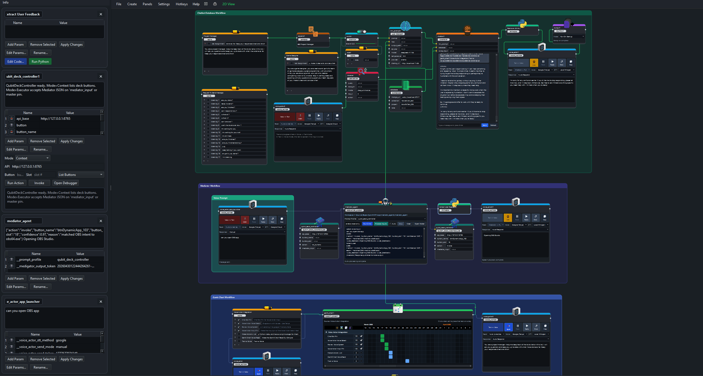
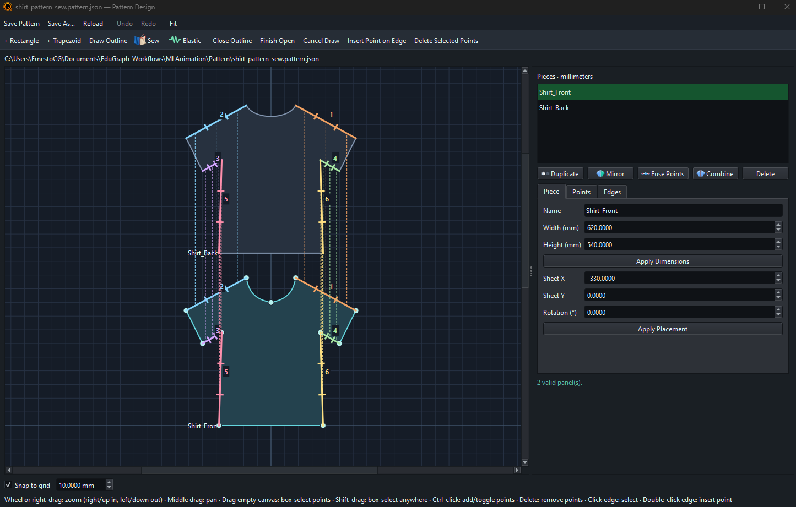
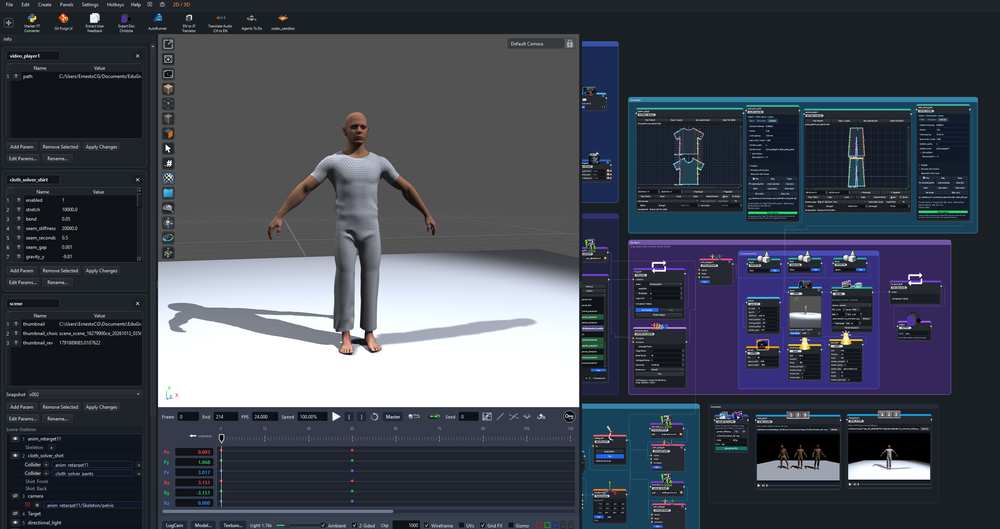
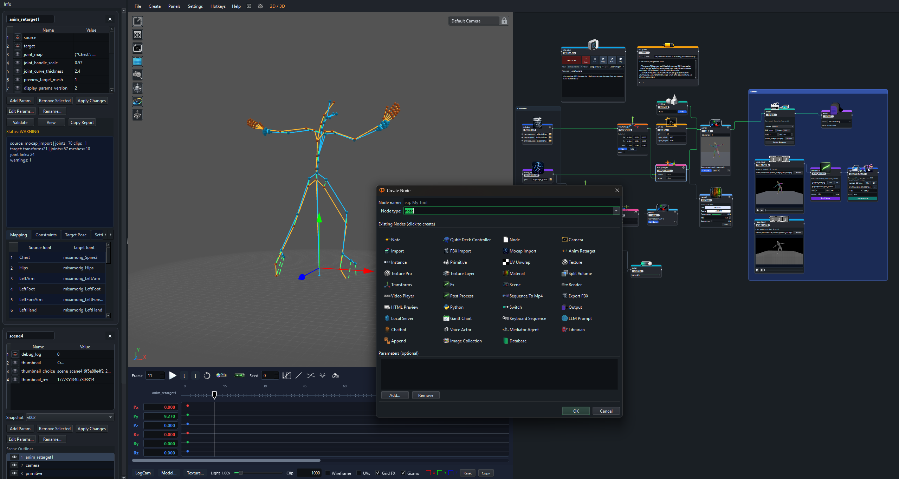
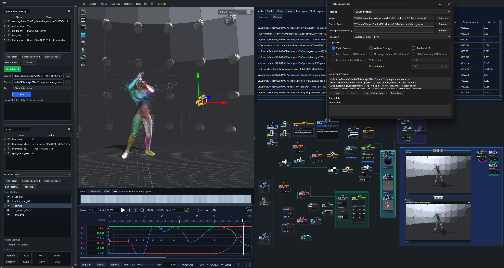

# Qubit Field · QubitMCP

### A visual workbench for ideas, tools, and production.

Qubit Field brings AI, knowledge, automation, media, and 3D creation into one node-based desktop workbench. Connect tools in a visual graph, inspect their results, and build reusable workflows that move from research and planning to animation, simulation, and delivery.

**QubitMCP is the source repository for the Qubit Field application.** Built for Windows with Python and PySide6, the workbench supports both local tools and connected services. Unreal Engine is one of its integrations, alongside workflows that run entirely in the desktop app.

[Documentation](https://quantalityfx.com/docs/qubit-mcp/) · [Node catalog](https://quantalityfx.com/docs/qubit-mcp/nodes.html) · [Download for Windows](https://github.com/QuantalityFX/QubitMCP/raw/refs/heads/Latest/downloads/QubitFieldInstaller.exe) · [Website](https://quantality.com) · [Discord](https://discord.com/invite/zJSKYZYZ)



## One workbench, many workflows

| Area | What you can do |
| --- | --- |
| **AI and knowledge** | Connect local or cloud language models, chat with voice, search documents with Librarian, organize facts in Data Nexus, and turn Skills and Task workflows into HTML decks and PDF output. |
| **Automation and planning** | Combine Python nodes, Mediator agents, Qubit Deck actions, keyboard sequences, serial/Pico controls, notes, and Gantt schedules. Use For Each to render collections or parameter variations. |
| **Motion and characters** | Generate motion from text with PriorMDM, extract mocap from video, organize BVH collections, retarget rigs, inspect joint limits, and blend from a bind pose into animation. |
| **Patterns and cloth** | Draft garment panels in a 2D editor, define sewing and elastic edges, arrange pieces in 3D, and simulate cloth with CPU or CUDA backends, collisions, pins, and saved caches. |
| **3D and visual effects** | Assemble scenes, model and select geometry, build materials and textures, groom guide curves, work with Gaussian splats, and preview lighting and animation in the viewport. |
| **Media and delivery** | Capture and translate audio, generate speech or video, review images and clips, render sequences, apply post effects, and export MP4, OBJ, or FBX assets. |

The graph is the common workspace: a document workflow can feed an agent, a motion collection can drive a render batch, and a pattern can become a simulated garment in the same scene as an animated character.

## Recent additions

- **Pattern Design and Cloth Solver** — reusable `.pattern.json` documents, mirrored panels, sewing tools, interactive cloth placement, animated colliders, timeline simulation, baking, and resumable saved states.
- **PriorMDM and rig previews** — text-to-motion generation, optional HandMDM hand gestures, and editable bend/twist limits with collision guides. Hand articulation remains a preview feature.
- **Mocap Collection and batch rendering** — BVH folder import, path relocation, render review, rename/archive tools, and paired For Each nodes for repeatable render runs.
- **Animation Blend, Delete Joint, and Look At** — a controlled transition into animation, derived skeleton cleanup, and object or joint targeting for scene constraints.
- **Voice and viewport improvements** — continuous audio capture with buffered speech recognition and app-audio exclusion, expanded rig editing, lighting controls, and selection previews.

Read the [current feature guide](https://quantalityfx.com/docs/qubit-mcp/#latest-updates), [pattern and cloth workflow](https://quantalityfx.com/docs/qubit-mcp/patterns-cloth.html), or [motion and batch-rendering workflow](https://quantalityfx.com/docs/qubit-mcp/motion.html). The editable documentation lives in [`Doc/`](Doc/).

## Inside the workbench

Click a screenshot to inspect the full interface.

| Pattern design | Cloth simulation |
| --- | --- |
| [](Doc/UISnapshot/PatternDesign_FullEditor.png) | [](Doc/UISnapshot/RealtimeClothSolver.png) |
| Draft, mirror, and sew reusable 2D panels. | Bring garments into an animated 3D scene. |

| Rig constraints and motion review | Animation workflows |
| --- | --- |
| [](Doc/UISnapshot/Collision%20Aware%20Rig%20Constraints_Thumb.png) | [](Doc/UISnapshot/AnimationWorkflow.png) |
| Inspect joint limits and review motion takes. | Connect motion, characters, and scene tools. |

[](Doc/UISnapshot/GaussianSplatFX.png)

*Gaussian splats, motion, and effects in the same workbench.*

## Get started

**Windows 10/11, 64-bit.** Use the [Windows installer](https://github.com/QuantalityFX/QubitMCP/raw/refs/heads/Latest/downloads/QubitFieldInstaller.exe), or clone the repository with Git and run these commands from its root:

```powershell
.\setup.bat
.\Run_QubitMCP.bat
```

Setup prepares the application and Librarian environments, dependencies, and voice support. It provisions an app-private Python 3.10 runtime when available. Internet access is needed for dependency and model downloads; GPU requirements and service credentials depend on the nodes you choose.

Press **Tab** to add a node, connect its ports, and use its controls to run or preview the result. Save the graph as a reusable workflow. Browse [`ExampleWorkflow/`](ExampleWorkflow/) for examples; update asset paths and service settings for your machine.

For launch troubleshooting and optional runtimes, see [Setup and Launch](https://quantalityfx.com/docs/qubit-mcp/#setup-launch). FBX support can be installed from the FBX node when needed. To read the docs locally, open [`Doc/index.html`](Doc/index.html) in a browser.

## Explore and extend

- [`nodes/`](nodes/) — node definitions and integrations.
- [`echograph/`](echograph/) — graph editor, viewport, motion, rigging, patterns, and physics code.
- [`Skills/`](Skills/) — templates and guides used by knowledge and agent workflows.
- [`Unreal/Plugins/MaterialGenerator/`](Unreal/Plugins/MaterialGenerator/) — Unreal material integration.
- [`Doc/`](Doc/) — static documentation website; open locally or export with `scripts\export_doc_childsite.bat` for the documentation host.

The README is the presentation shown on the GitHub repository home page. The hosted documentation is a separate static site: pushing changes updates the repository, and the `Doc/` site must also be exported and uploaded to update the documentation host.

## Connect

[Website](https://quantality.com) · [Email](mailto:quantalityfx@gmail.com) · [Discord](https://discord.com/invite/zJSKYZYZ) · [YouTube](https://www.youtube.com/@vimpassion) · [LinkedIn](https://www.linkedin.com/in/ernesto-marrero-7760092a/) · [Instagram](https://www.instagram.com/vimpassion/)

Qubit Field is **source-available** under the [Qubit MCP Source-Available License](LICENSE). See the license for permitted uses and restrictions.
